# Cabinet Designer

Parametric cabinet design in the browser for hobbyist and small-shop woodworkers. Design
cabinets, see them in 3D, lay them out in a room, and take an accurate cut list, sheet layouts
and a printed shop packet to the saw. It works locally, with no account or server: projects are
saved in the browser.

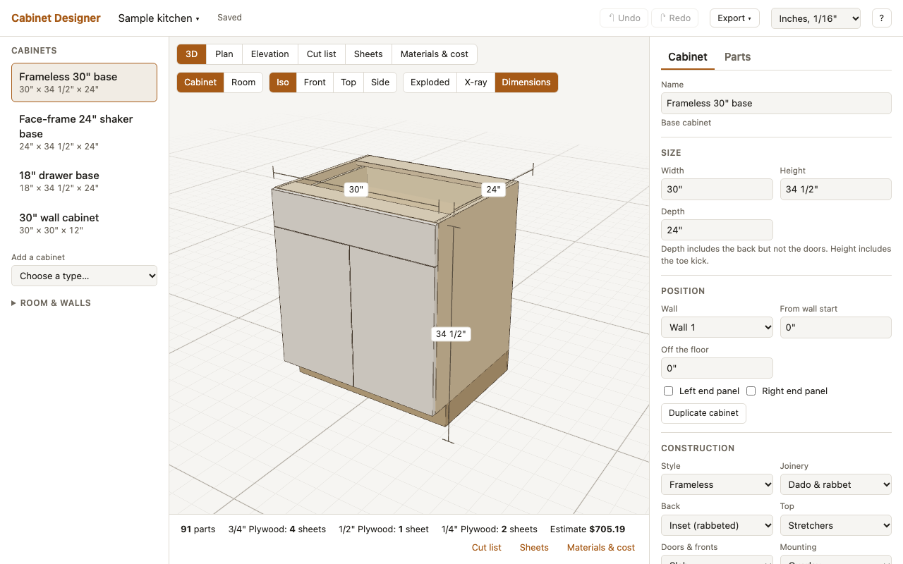

## What it does

**Cabinets.**

- Types: base, drawer base, wall, tall, open shelving, blind corner base and wall, and
  L-shaped base (bi-fold doors) and open shelving for inside corners.
- Frameless or face frame, with dado, rabbet, butt or pocket-screw joinery.
- Inset, applied or grooved backs; slab or shaker fronts.
- Every construction convention (reveals, toe kick, drawer clearances, banding and so on) can
  be edited per project or per cabinet. They are documented with worked examples in
  [docs/CONSTRUCTION.md](docs/CONSTRUCTION.md).
- Sizes accept `23 1/4`, `23-1/4"`, `1' 11 1/4"`, `590mm` or `59 cm`, in imperial or metric
  projects.

**Fronts.** Split the face into rows and columns of doors, drawers and open shelves by clicking
the front elevation.

| 3D, exploded                                       | Whole room                                 |
| -------------------------------------------------- | ------------------------------------------ |
| 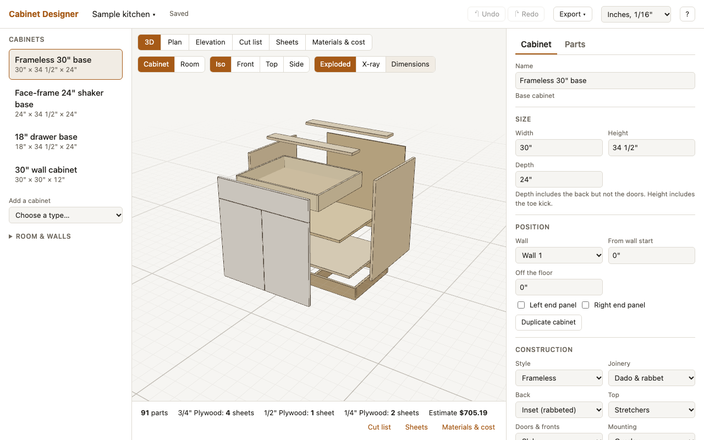 | 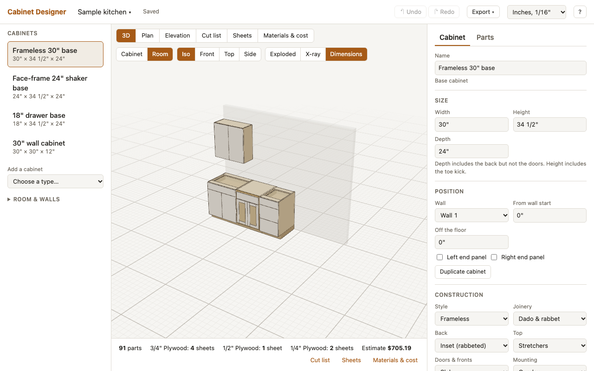 |

**Room layout.**

- Straight, L and U wall runs.
- Drag cabinets along a wall in plan or elevation, with snapping to wall ends and neighbours,
  or use the arrow keys.
- Overlap warnings, fillers that fit a gap exactly, and end panels.

| Plan                                    | Wall elevation                                    |
| --------------------------------------- | ------------------------------------------------- |
| 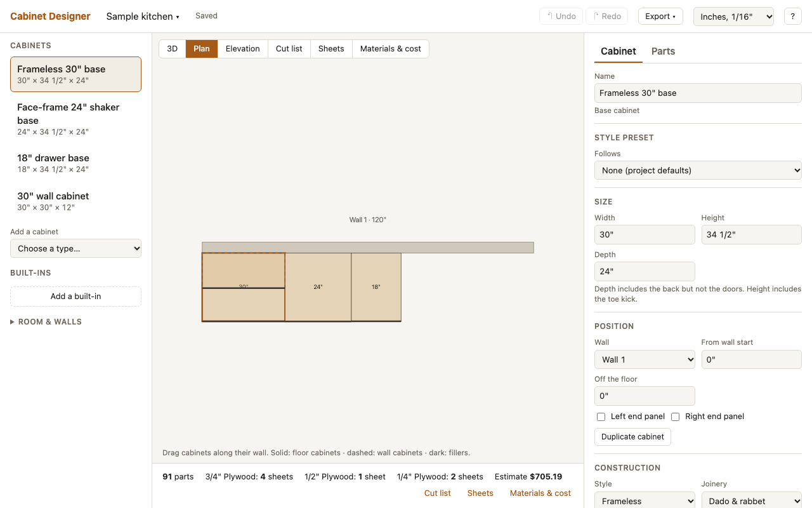 | 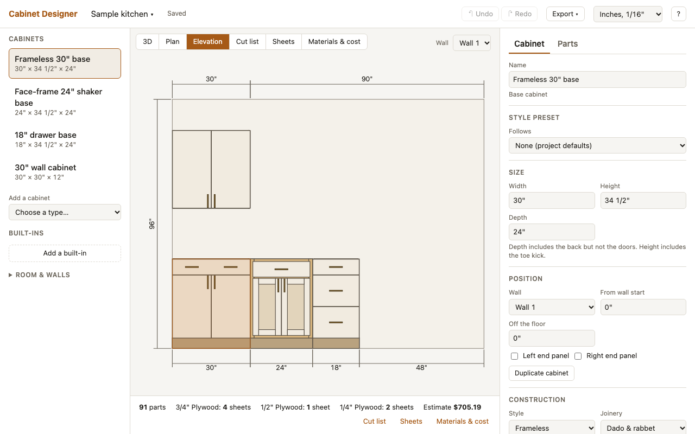 |

**Built-ins.** Wall-to-wall furniture-style built-ins: runs of base cabinets with open shelving
or a TV niche above, towers, pilasters, and openings such as a fireplace
([spec](docs/BUILTIN-SPEC.md)).

- Style presets: one change restyles every box (door style, inset or overlay, paint, knobs or
  pulls, shelf nosing, plinth, end panels).
- The countertop height, shelf lines and the line under the frieze are shared across each run,
  and stiles line up between the bases and uppers.
- The run owns its trim: countertop, frieze, crown and base moulding run across the boxes,
  mitre at inside corners and return at open ends. Mouldings are bought by length, with mitre
  counts. Picture lights are counted as hardware.
- Inside corners between runs: a blind corner base (one run's end box carries on into the
  corner) and wrap-around open shelves (one L of shelves through the corner), or a dead corner
  with fillers. Chosen per corner.
- Quick-add: wall layouts (media wall, fireplace wall, bookcases), and runs that fit
  themselves to the run round the corner. The spec's two-wall reference room takes 10 actions.
  Its cut list and shopping list are in [docs/golden](docs/golden/).

| Built-ins in the room                                        | Media wall elevation                                            |
| ------------------------------------------------------------ | --------------------------------------------------------------- |
| 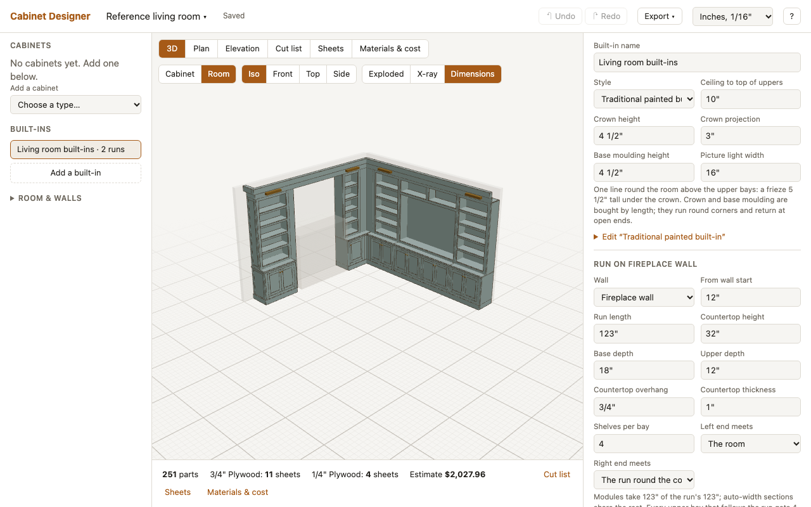 | 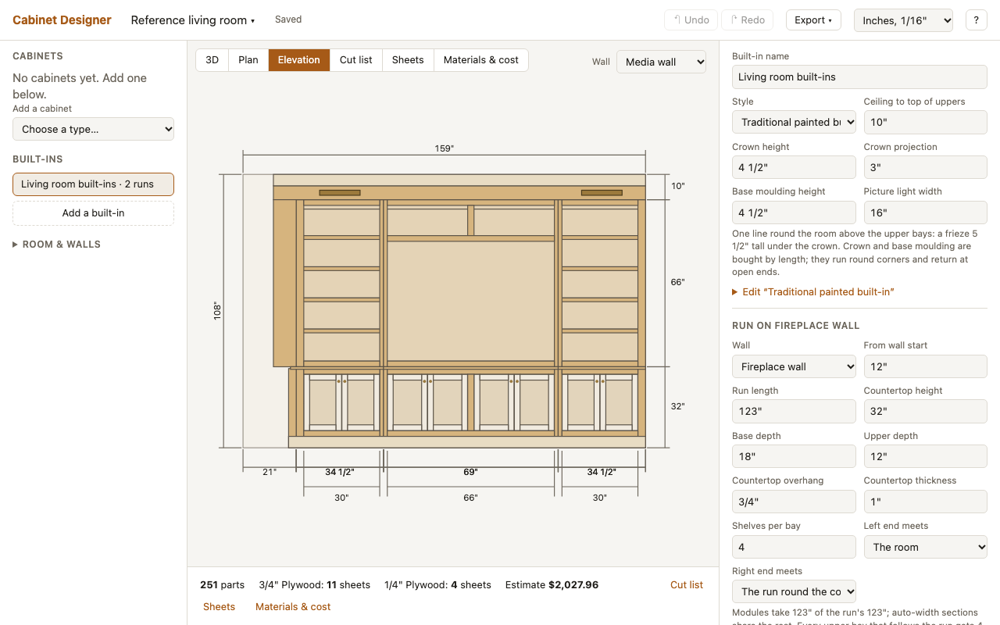 |

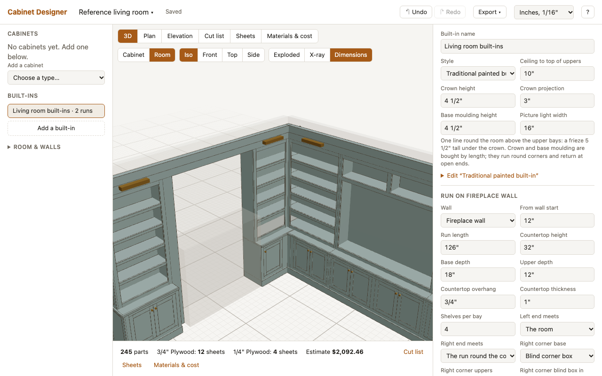

**Shop outputs.** Everything is recomputed as you edit:

- The cut list: identical and mirror-image parts merged; cut sizes with banding subtracted;
  grain, edges and notes.
- Sheet layouts: guillotine cuts only (table saw or track saw), with a numbered cut order in
  plain language, kerf and edge trim, and grain respected.
- A shopping list and estimate: sheets, board feet, edge banding, mouldings and hardware.

| Cut list                                   | Sheet layouts                                 |
| ------------------------------------------ | --------------------------------------------- |
| 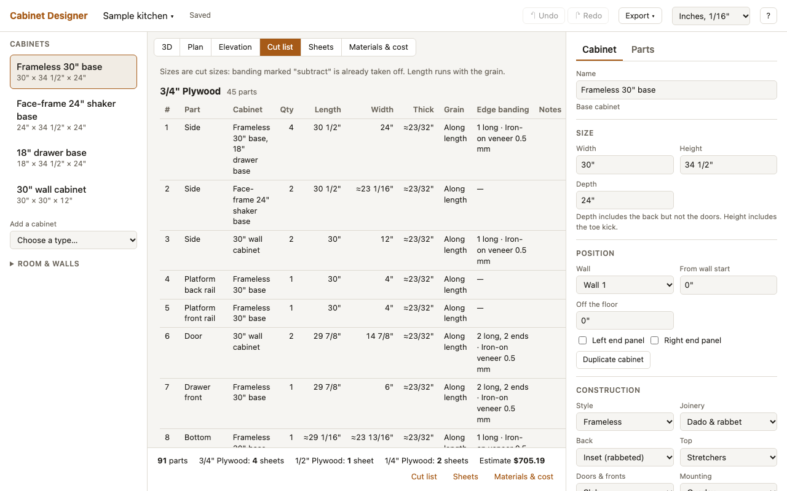 | 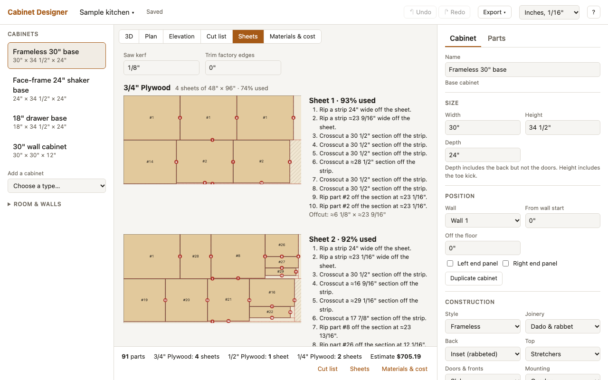 |

**Export.**

- A PDF shop packet: cover, wall and cabinet elevations, cut list, one page per sheet with its
  cuts, and a shopping list.
- The cut list and shopping list as CSV, with exact decimals for other tools.
- The project as JSON, which can be imported again.

**Also.**

- Undo/redo.
- Keyboard shortcuts: press `?` in the app.
- A layout for tablets, where the side panels slide in.
- Accessibility: axe-clean in light and dark mode, and usable from the keyboard.

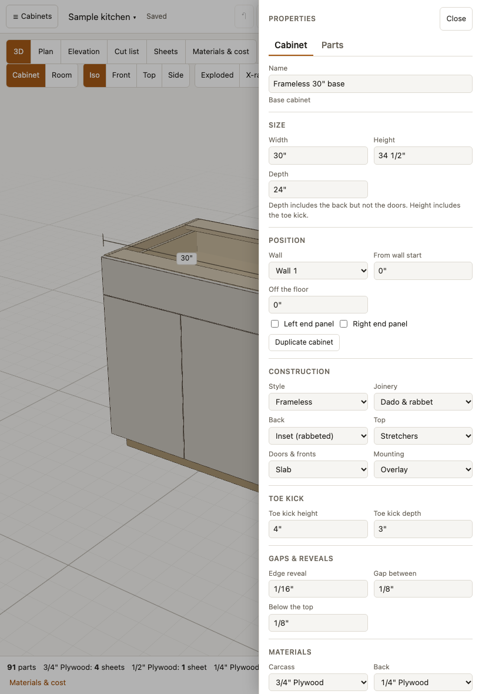

## Accuracy

Lengths are stored in millimetres, quantised to 1 nm, and only rounded for display. A rounded
size is always marked with `≈`, never rounded silently. Every cabinet type is covered by:

- Golden cut lists checked by hand.
- A 192-combination construction matrix.
- Property tests over thousands of random cabinets. These check that parts stay inside the
  cabinet and touch only at declared joints, by exactly the joint depth.

Sheet layouts are property-tested for overlaps, kerf, grain and guillotine-valid cuts.

## Development

Requires Node 22+ (`.nvmrc` pins 26).

```sh
npm install
npm run dev          # dev server
npm test             # unit tests (Vitest)
npm run coverage     # unit tests + coverage thresholds
npm run e2e          # Playwright (first run: npx playwright install chromium)
npm run lint         # ESLint + Prettier check
npm run typecheck    # core, app and tooling tsconfigs
npm run screenshots  # regenerate docs/screenshots
```

## Layout

- `src/core/`: pure TypeScript domain logic, with no React, three.js or browser APIs (enforced
  by tsconfig and ESLint). It covers:
  - units, the data model and part generation
  - room layout and 2D drawings
  - cut list, nesting and costing
  - report text and CSV
- `src/app/`: the React UI, the 3D viewer (React Three Fiber) and the PDF shop packet
  (`src/app/pdf`).
- `e2e/`: Playwright tests, including the full journey, accessibility and a 64-cabinet
  kitchen.
- `docs/`:
  - [PLAN.md](docs/PLAN.md): scope and milestones
  - [DECISIONS.md](docs/DECISIONS.md): the decision log
  - [CONSTRUCTION.md](docs/CONSTRUCTION.md): construction formulas and golden cut lists
